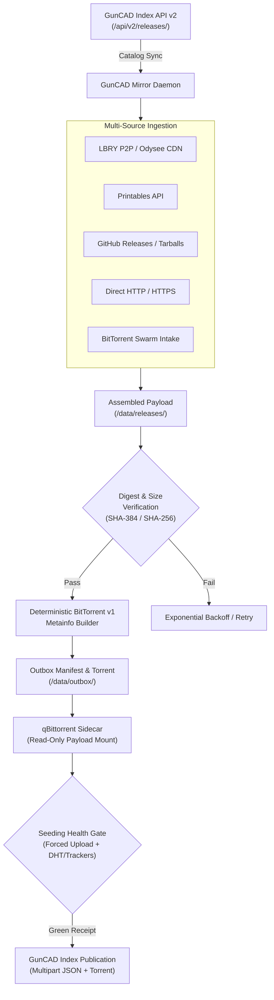

# GunCAD Mirror

[](https://www.python.org/downloads/)
[](LICENSE.md)
[](https://github.com/daailouivan/guncad-index-mirror/pkgs/container/guncad-mirror)
[]()
[](https://github.com/astral-sh/ruff)

> [!WARNING]
> GunCAD Mirror has not had a stable release. Index publication is opt-in and writes production records to GunCAD Index. Test endpoints and credentials against a non-production Index before enabling publication on an existing archive.

> [!WARNING]
> This software downloads, verifies, and seeds 3D-printable firearm files and CAD designs. Possession, export, or distribution may be restricted or illegal in your jurisdiction. The operator is solely responsible for complying with all applicable local, national, and international laws.

GunCAD Mirror is an autonomous multi-source archival bridge and seeding engine for 3D-printable firearms, CAD models, and technical documentation. It aggregates catalog releases from **GunCAD Index API v2**, retrieves payloads across multiple decentralized and centralized networks, validates cryptographic digests against ledger baselines, generates deterministic BitTorrent v1 artifacts, and seeds them continuously via **qBittorrent**.

---

## Table of Contents

- [Key Capabilities](#key-capabilities)
- [Architecture & Data Pipeline](#architecture--data-pipeline)
- [Multi-Source Ingestion](#multi-source-ingestion)
- [WebUI & Operator Experience](#webui--operator-experience)
  - [Dashboard & Multi-Source Matrix](#dashboard--multi-source-matrix)
  - [Browsable Archive Browser](#browsable-archive-browser)
  - [Rich Release Details Modal](#rich-release-details-modal)
  - [In-Archive File Inspector](#in-archive-file-inspector)
  - [Local Location & Seeding Integrity Protection](#local-location--seeding-integrity-protection)
- [Resource Profiles & Modularity](#resource-profiles--modularity)
- [Quick Start](#quick-start)
  - [Standard Docker Compose](#standard-docker-compose)
  - [VPN-Isolated Stack with Gluetun (PIA)](#vpn-isolated-stack-with-gluetun-pia)
  - [Podman & Rootless Deployment](#podman--rootless-deployment)
- [Configuration Reference](#configuration-reference)
- [Durable State Machines](#durable-state-machines)
- [Tracker Policy & Torrent Identity](#tracker-policy--torrent-identity)
- [Integrity Audit & Forensics](#integrity-audit--forensics)
- [Data Layout](#data-layout)
- [Upgrading & Migration](#upgrading--migration)
- [Development & Verification](#development--verification)
- [License & Community](#license--community)

---

## Key Capabilities

- **Multi-Source Ingestion**: Ingests releases from LBRY/Odysee, Printables, GitHub, direct HTTP/HTTPS downloads, and BitTorrent swarms.
- **Cryptographic Verification**: Enforces exact SHA-384 and SHA-256 digest validation alongside strict file size matching before any release is accepted.
- **Deterministic BitTorrent v1**: Produces bit-for-bit identical, trackerless BitTorrent v1 metainfo files and canonical magnet URIs regardless of local operator configuration.
- **Zero-Copy qBittorrent Seeding**: Manages a paired qBittorrent instance via its Web API, seeding completed payloads in place without duplicating storage.
- **Dynamic Seeding Health Gate**: Publishes canonical torrents to the Index only when qBittorrent reports forced upload mode, 100% verified pieces, and active DHT or working tracker connectivity.
- **Runtime Resource Profiles**: Run a lightweight daemon by default, with opt-in runtime WebUI and environment toggles for rich metadata and in-archive zip inspection.
- **Non-Destructive Local File Inspection**: Inspect zip archive contents, filter by CAD extensions (`.stl`, `.step`, `.3mf`, `.pdf`), and download individual files without corrupting seeding piece hashes.

---

## Architecture & Data Pipeline



---

## Multi-Source Ingestion

GunCAD Mirror is not limited to a single distribution network. It ingests catalog entries across five distinct transports:

1. **LBRY / Odysee (`lbry`)**:
   - Queries stream descriptor hashes (`sd_hash`) directly through the embedded `lbrynet` P2P daemon.
   - If P2P acquisition exhausts retries, optionally falls back to Odysee's public CDN (`player.odycdn.com`) with HTTP range-resumption, requiring claim ID, descriptor hash, size, and SHA-384 corroboration.
2. **Printables (`printables`)**:
   - Queries the Printables public API with configurable request pacing (`MIRROR_PRINTABLES_PACING`) and concurrency limits to respect upstream rate guidelines.
3. **GitHub (`github`)**:
   - Ingests repository releases, asset downloads, and source code tarballs.
   - Supports personal access tokens (`MIRROR_GITHUB_TOKEN` or dynamic UI configuration) to raise API rate limits from **60 req/hr** to **5,000 req/hr**, automatically resetting rate-limited jobs upon token entry.
4. **Direct HTTP (`http`)**:
   - Downloads hosted releases and mirrors from public HTTP and HTTPS endpoints with resume support and strict chunked checksum verification.
5. **BitTorrent Swarm (`torrent`)**:
   - Ingests external torrents and magnet URIs through qBittorrent intake categories (`MIRROR_TORRENT_INTAKE_CATEGORY`), packaging the resulting payload into the standard verified directory hierarchy.

---

## WebUI & Operator Experience

Mirror serves a web interface on host port `8081` (configurable via `MIRROR_ENABLE_WEBUI=true`).

### Dashboard & Multi-Source Matrix

The dashboard (`http://localhost:8081/`) gives operators live visibility into node health:

- **Current Activity**: Active transfer progress bars, blob counters, transfer rates, and remaining time estimates.
- **Mirror Summary Metrics**: Count of staged torrents, green seeders, Index receipts, failed jobs, durable jobs, and volume utilization.
- **Ingestion Sources Breakdown**: Matrix breaking down catalog releases by source platform against local pipeline stages:
  - *Indexed Total*, *Staged/Verified*, *qB Seeding*, *Index Published*, *In-flight*, *Failed*, *Excluded by Policy*, and *Payload Volume*.
  - Clicking any cell opens a live filter modal with real-time search, sorting, and pagination.
- **Interactive Operator Actions**:
  - **Batch Retry**: Retry all failed jobs across all sources or filtered by specific platform.
  - **Exclude / Re-include**: Flag non-model or undesired items as excluded without altering upstream catalog records.
  - **GitHub Token Manager**: Add or update tokens live with masked value preview and immediate reset of rate-limited jobs.

### Browsable Archive Browser

Accessible at `http://localhost:8081/archive`, the archive browser allows searching all completed and verified models:

- Search by release name, channel handle, slug, ID, or descriptor hash.
- Filter by upstream platform (LBRY, Printables, GitHub, HTTP, BitTorrent).
- Direct HTTP downloads for assembled payloads (`/archive/<id>/<sd>/payload`) and `.torrent` files.
- Displays canonical magnet URIs, DHT node counts, and working tracker statuses.

### Rich Release Details Modal

When `catalog_details` is enabled:
- Click **📖 Details** on any release in the dashboard or archive.
- View upstream release notes and descriptions with safe Markdown rendering (links, formatting, code blocks).
- Inspect creator channel handles, names, upstream origin buttons, and categorized tags.
- Verify cryptographic specifications: Payload size, Release ID, SHA-384, SHA-256, BTIH, and live seeding health.

### In-Archive File Inspector

When `archive_inspector` is enabled:
- Click **📦 Files** on any archive card or from inside the Release Details modal.
- Deep-inspect `.zip` packages without decompressing to disk.
- Real-time search filter for filenames and paths.
- Extension filter chips (`All`, `STL`, `3MF`, `STEP`, `PDF`, `TXT`).
- Single-file download (`/archive/<id>/<sd>/file?path=...`): Stream individual STLs, assembly guides, or READMEs with `X-Content-Type-Options: nosniff` while keeping the seeded archive intact.

### Local Location & Seeding Integrity Protection

Clicking **📂 Local Location** opens a dedicated path inspection modal:
- Displays exact local container folder path and file path.
- Displays mapped host folder path (`MIRROR_HOST_DATA_DIR`) for NAS operators (e.g., Unraid `/mnt/user/...` or Synology `/volume1/...`).
- One-click clipboard copy buttons for folder and file paths.
- **Seeding Integrity Caution**: Warns operators that modifying, renaming, unzipping in-place, or moving files inside active seed folders will corrupt BitTorrent piece hashes and break seeding health checks.
- Highlights the **Preferred Workflow**: Always download an additional copy or copy files out of the archive folder before slicing, CAD editing, or printing.
- Optional **Open in File Manager** action to trigger host file managers via container IPC.

---

## Resource Profiles & Modularity

Mirror supports configurable resource profiles to suit hardware ranging from low-power SBCs/NAS appliances to dedicated archival servers:

| Resource Profile | Memory Footprint | CPU Usage | Capabilities |
| :--- | :--- | :--- | :--- |
| **Lightweight Mirror** *(Default)* | Minimal (~150MB) | Very Low | Core pipeline, verification, seeding, basic archive browser, location modal |
| **Enriched Catalog** | Low (~180MB) | Low | + Rich Markdown release notes, upstream links, tags, and cryptographic specs |
| **Complete Index Experience** | Moderate (~220MB) | Moderate on-demand | + Enriched Catalog + In-Archive Zip Inspection and Single-File Downloads |

Profiles can be configured via environment variables or **toggled live at runtime without restarting the container** in the WebUI Dashboard. Toggles are persisted across restarts in `/data/mirror-state.sqlite3`.

---

## Quick Start

### Standard Docker Compose

Create a `guncad-mirror.env` configuration file:

```bash
cp guncad-mirror.env.example guncad-mirror.env
# Set MIRROR_QBITTORRENT_PASSWORD and desired endpoints
```

Launch the stack:

```bash
docker compose --env-file guncad-mirror.env up -d
```

The stack runs two containers:
- `guncad-mirror`: Ingestion daemon, verification pipeline, and WebUI on port `8081`.
- `guncad-qbittorrent`: BitTorrent seeder with Mirror's `/data` mounted read-only at `/downloads`.

### VPN-Isolated Stack with Gluetun (PIA)

To route all BitTorrent peer traffic through Private Internet Access (PIA) with automatic port forwarding while keeping Mirror's HTTP/P2P ingestion on the host connection:

1. Copy and configure the PIA credentials:
   ```bash
   cp .pia.env.example .pia.env
   chmod 600 .pia.env
   ```
2. Start the Gluetun Compose stack:
   ```bash
   docker compose \
       --env-file guncad-mirror.env \
       --env-file .pia.env \
       -f docker-compose.gluetun.yml \
       up -d
   ```
3. Gluetun manages the VPN tunnel and writes the dynamically assigned port to a shared volume. Mirror synchronizes qBittorrent's listening port automatically using `contrib/gluetun-qbittorrent-port.sh`.

### Podman & Rootless Deployment

Podman Compose can be used with the same stack:

```bash
set -a
. ./guncad-mirror.env
set +a
podman compose up -d
```

Ensure the host directory mounted to `/data` is writable by UID `1000`.

---

## Configuration Reference

All byte quantities are integers. Time durations are in seconds. Booleans accept `true`, `false`, `1`, `0`, `yes`, `no`, `on`, and `off` (case-insensitive).

### General & Ingestion Endpoints

| Variable | Default | Purpose |
| :--- | :---: | :--- |
| `MIRROR_API_ENDPOINT` | `https://guncadindex.com/api/v2/releases/?format=json&limit=100` | GunCAD Index API v2 catalog or filtered search URL. |
| `MIRROR_DATA_DIR` | `/data` | Root path for state, releases, and outbox artifacts. |
| `MIRROR_HOST_DATA_DIR` | empty | Host-side path (e.g. `/mnt/user/...`) displayed in Local Location modal. |
| `MIRROR_API_MAX_PAGES` | `1000` | Maximum pages followed in a single scan. |
| `MIRROR_MAX_RELEASES_PER_RUN` | `0` | Cap on releases processed per cycle (`0` = unconstrained). |
| `MIRROR_LOOP_INTERVAL` | `14400` (4h) | Interval between completed catalog scans. |
| `MIRROR_CYCLE_ERROR_INTERVAL` | `60` | Delay before retrying a scan aborted by an error. |
| `MIRROR_RELEASE_MAX_SIZE` | `10737418240` (10GB) | Maximum accepted release payload size (`0` = unlimited). |
| `MIRROR_MIN_FREE_SPACE` | `5368709120` (5GB) | Minimum free disk space required before starting a download. |
| `MIRROR_ENABLE_WEBUI` | `false` | Enable the WebUI dashboard and archive browser on port `8081`. |
| `MIRROR_BLACKLISTED_HANDLES` | empty | Comma-separated channel prefixes to skip (e.g. `@author#a`). |

### Multi-Source Transports

| Variable | Default | Purpose |
| :--- | :---: | :--- |
| `MIRROR_LBRY_URL` | `http://127.0.0.1:5279` | JSON-RPC endpoint for the local `lbrynet` daemon. |
| `MIRROR_LBRY_CONCURRENCY` | `4` | Maximum concurrent LBRY stream downloads. |
| `MIRROR_LBRY_STARTUP_TIMEOUT` | `300` | Seconds to wait for `lbrynet` daemon startup. |
| `MIRROR_ODYSEE_FALLBACK` | `true` | Fallback to Odysee CDN when LBRY peer acquisition fails. |
| `MIRROR_ODYSEE_PROXY_URL` | `https://api.na-backend.odysee.com/api/v1/proxy` | Public Odysee SDK proxy used for verified CDN resolution. |
| `MIRROR_ODYSEE_CONCURRENCY` | `2` | Maximum concurrent Odysee CDN downloads. |
| `MIRROR_PRINTABLES_CONCURRENCY` | `2` | Maximum concurrent Printables downloads. |
| `MIRROR_PRINTABLES_PACING` | `2.0` | Pacing delay between Printables API calls. |
| `MIRROR_GITHUB_TOKEN` | empty | GitHub PAT to boost API rate limit to 5,000 req/hr. |
| `MIRROR_GITHUB_CONCURRENCY` | `2` | Maximum concurrent GitHub asset downloads. |
| `MIRROR_HTTP_CONCURRENCY` | `2` | Maximum concurrent direct HTTP/HTTPS downloads. |
| `MIRROR_TORRENT_CONCURRENCY` | `2` | Maximum concurrent BitTorrent intake downloads. |
| `MIRROR_TORRENT_INTAKE_CATEGORY`| `guncad-intake` | qBittorrent category for inbound swarm transfers. |
| `MIRROR_FINALIZE_CONCURRENCY` | `2` | Maximum concurrent verification & piece hashing workers. |

### Optional Feature Flags

| Variable | Default | Purpose |
| :--- | :---: | :--- |
| `MIRROR_ENABLE_CATALOG_DETAILS` | `false` | Enables rich release descriptions, Markdown rendering, tags, and hash specs. Can be toggled live via WebUI. |
| `MIRROR_ENABLE_ARCHIVE_INSPECTOR`| `false` | Enables deep zip archive inspection and single-file downloads. Can be toggled live via WebUI. |

### qBittorrent Integration

| Variable | Default | Purpose |
| :--- | :---: | :--- |
| `MIRROR_QBITTORRENT_ENABLED` | `false` | Enable automated seeding reconciliation via qBittorrent Web API. |
| `MIRROR_QBITTORRENT_URL` | `http://qbittorrent:8080` | Internal URL to qBittorrent Web API. |
| `MIRROR_QBITTORRENT_USERNAME` | empty | Web API username. |
| `MIRROR_QBITTORRENT_PASSWORD` | empty | Web API password. |
| `MIRROR_QBITTORRENT_DATA_DIR` | `/downloads` | Mount path inside qBittorrent corresponding to Mirror's `/data`. |
| `MIRROR_QBITTORRENT_RECHECK_INTERVAL`| `300` (5m) | Interval between seed health verifications. |
| `MIRROR_QBITTORRENT_CATEGORY` | `guncad-mirror` | Category applied to managed seeding torrents. |
| `MIRROR_QBITTORRENT_TAG` | `guncad-mirror` | Tag applied to managed seeding torrents. |

### Index Publication (Opt-In)

| Variable | Default | Purpose |
| :--- | :---: | :--- |
| `MIRROR_PUBLISH_ENABLED` | `false` | Enable publication of verified torrents to GunCAD Index. |
| `MIRROR_PUBLISH_URL` | empty | Absolute HTTP(S) torrent publication endpoint. |
| `MIRROR_PUBLISH_TOKEN` | empty | High-entropy bearer token sent in `Authorization` header. |
| `MIRROR_PUBLISH_CONCURRENCY` | `2` | Maximum SHA-384 candidate groups published in parallel. |

---

## Durable State Machines

All job records are maintained in SQLite at `/data/mirror-state.sqlite3`.

### Acquisition Pipeline

```text
pending ──> acquiring ──> verified ──> awaiting_index (Terminal Staged)
               │
               ├──> failed ──> acquiring (after exponential backoff)
               └──> excluded ──> acquiring (if policy changes)
```

- `awaiting_index`: File assembled, cryptographic digests verified, and BitTorrent metainfo written to outbox.
- `failed`: Retained with error classification and exponential backoff schedule.
- `excluded`: Releases filtered by size or blacklist rules.

### Seeding Health Gate

```text
pending ──> injecting ──> green ──> injecting (when 5m receipt expires)
               │            │
               │            └──> blocked (path/hash/completion mismatch)
               └──> retrying ──> injecting
```

- `green`: qBittorrent confirms identical BTIH, exact file path, 100% completion, forced upload mode, and active peer discovery (DHT > 0 or working tracker).
- Only active `green` seed receipts allow Index publication.

### Index Publication Pipeline

```text
pending ──> publishing ──> published (Receipt stored)
               │
               ├──> duplicate (Winner recorded)
               ├──> conflict / rejected
               └──> retrying (Network / 5xx)
```

---

## Tracker Policy & Torrent Identity

- **Trackerless Metainfo**: Outbox `.torrent` files and Index submissions are strictly trackerless. Two operators hashing the same payload produce identical `info_hash` / BTIH values without tracker coordination.
- **Dynamic Runtime Hints**: On each seeding cycle, Mirror fetches the public Index tracker policy and reconciles qBittorrent trackers using:
  $$\text{Effective Trackers} = (\text{Index Enabled} \cup \text{MIRROR\_TORRENT\_TRACKERS}) \setminus \text{Index Blacklisted}$$
- Existing torrent files remain immutable; runtime tracker changes occur solely within qBittorrent memory.

---

## Integrity Audit & Forensics

Run the built-in audit utility to verify archive consistency:

```bash
# Fast census validation (ledger, paths, outbox torrents, and qBittorrent receipts)
python -m guncadmirror.audit --data-dir /data

# Full bit-rot scrub (re-reads and recomputes SHA-384 and SHA-256 over entire plaintext corpus)
python -m guncadmirror.audit --data-dir /data --rehash
```

Generated reports are written to `/data/reports/`:
- `archive-summary.json`: High-level inventory, byte totals, and health status.
- `archive-artifacts.csv`: Detailed ledger of all staged jobs and cryptographic hashes.
- `archive-failures.csv`: Acquisition failures with timestamps and error traces.
- `archive-exclusions.csv`: Policy-filtered releases with reasons.
- `archive-issues.csv`: Corrupt files, missing paths, or orphaned manifests.

---

## Data Layout

| Container Path | Purpose |
| :--- | :--- |
| `/data/releases/<channel>/<release>-<sd>/` | Assembled plaintext payloads and original `release.json`. |
| `/data/outbox/<release-id>/<sd-hash>/` | Deterministic `.torrent` metainfo and `manifest.json`. |
| `/data/mirror-state.sqlite3` | SQLite ledger: jobs, retries, seeding receipts, and settings. |
| `/data/lbry/` | `lbrynet` wallet headers, stream database, and cached P2P blobs. |
| `/data/reports/` | Audit summaries, CSV censuses, and forensic reports. |
| `/data/log/` | Rotating application and daemon logs. |

---

## Upgrading & Migration

### Upgrading from 0.4.x
1. Reuse your existing `/data` volume. Mirror detects `/data/lbry` and reuses existing blobs without re-downloading from the LBRY network.
2. If `MIRROR_ASSEMBLE_FILES=True` was used in 0.4.1, intact payloads in `/data/mirror` are automatically recognized and verified.
3. The legacy pickle cache (`/data/sd_hash_cache.pkl`) is replaced by the SQLite ledger. Existing files are validated once upon startup.

### V1-to-V2 Migration Tool
For operators migrating an existing archive share:

```bash
python -m guncadmirror.migration --data-dir /data --bootstrap-dir /path/to/bootstrap
```

---

## Development & Verification

### Running Tests & Quality Checks

Mirror requires Python 3.12+ and uses `uv` or `venv`:

```bash
# Install dependencies
uv sync

# Format and lint
ruff format .
ruff check .
djlint guncadmirror/templates --check

# Run test suite with strict coverage verification (>= 95%)
python -W error::ResourceWarning -m coverage run -m unittest discover -v
python -m coverage report --show-missing --skip-covered --fail-under=95
```

### Docker Build

```bash
docker build -t guncad-mirror:latest .
```

---

## License & Community

- **License**: GunCAD Mirror is licensed under the [GNU Affero General Public License v3.0](LICENSE.md).
- **Fonts**: Bundled IBM Plex Mono fonts are licensed under the [SIL Open Font License 1.1](https://scripts.sil.org/OFL).
- **Community & Operator Support**: Join the discussion on the [GunCAD Index Matrix Space](https://matrix.to/#/#guncad-index:matrix.org).
